# Class Diagram: Sistem Manajemen Aset dan Peminjaman (Aset-Pinjam)

Dokumen ini memodelkan struktur kelas, atribut, metode, visibilitas, tipe data, paket, serta relasi dan multiplisitas antar kelas pada sistem `Aset-Pinjam`, sesuai dengan implementasi kode aktual pada modul `core`.

## Visualisasi Class Diagram

```mermaid
classDiagram
    direction TB

    namespace id_ac_upb_asetpinjam_kontrak {
        class DapatDipinjam {
            <<interface>>
            +bisaDipinjam() bool
        }
        class AturanDenda {
            <<interface>>
            +hitung(Aset aset, int hariTerlambat) long
        }
    }

    namespace id_ac_upb_asetpinjam_model {
        class JenisAset {
            <<enumeration>>
            RUANG
            LAPTOP
            ALAT_LAB
        }
        class Kondisi {
            <<enumeration>>
            BAIK
            RUSAK_RINGAN
            RUSAK_BERAT
        }
        class StatusAset {
            <<enumeration>>
            TERSEDIA
            DIPINJAM
            RUSAK
        }
        class StatusPeminjaman {
            <<enumeration>>
            DIAJUKAN
            DISETUJUI
            DITOLAK
            DIPINJAM
            DIBATALKAN
            DIKEMBALIKAN
            TERLAMBAT
        }
        class TingkatRisiko {
            <<enumeration>>
            RENDAH
            SEDANG
            TINGGI
        }
        class Peminjam {
            <<record>>
            -String id
            -String nama
            +Peminjam(String id, String nama)
            +id() String
            +nama() String
        }
        class Aset {
            <<abstract>>
            -String kode
            -String nama
            -StatusAset status
            -Kondisi kondisi
            +Aset(String kode, String nama)
            +getKode() String
            +getNama() String
            +getStatus() StatusAset
            +getKondisi() Kondisi
            +setNama(String nama) void
            +setStatus(StatusAset status) void
            +setKondisi(Kondisi kondisi) void
            +bisaDipinjam() bool
            +getJenis()* JenisAset
            +hitungDenda(int hariTerlambat)* long
        }
        class Ruang {
            -int kapasitas
            +Ruang(String kode, String nama, int kapasitas)
            +getKapasitas() int
            +getJenis() JenisAset
            +hitungDenda(int hariTerlambat) long
        }
        class Laptop {
            -String spesifikasi
            -String nomorInventaris
            +Laptop(String kode, String nama, String spesifikasi, String nomorInventaris)
            +getSpesifikasi() String
            +getNomorInventaris() String
            +getJenis() JenisAset
            +hitungDenda(int hariTerlambat) long
        }
        class AlatLab {
            -String laboratorium
            -TingkatRisiko tingkatRisiko
            +AlatLab(String kode, String nama, String laboratorium, TingkatRisiko tingkatRisiko)
            +getLaboratorium() String
            +getTingkatRisiko() TingkatRisiko
            +getJenis() JenisAset
            +hitungDenda(int hariTerlambat) long
        }
        class Peminjaman {
            -String id
            -Peminjam peminjam
            -Aset aset
            -LocalDateTime mulai
            -LocalDateTime selesai
            -StatusPeminjaman status
            +Peminjaman(String id, Peminjam peminjam, Aset aset, LocalDateTime mulai, LocalDateTime selesai)
            +getId() String
            +getPeminjam() Peminjam
            +getAset() Aset
            +getMulai() LocalDateTime
            +getSelesai() LocalDateTime
            +getStatus() StatusPeminjaman
            +setStatusDariPenyimpanan(StatusPeminjaman status) void
            +ubahStatus(StatusPeminjaman baru) void
        }
    }

    namespace id_ac_upb_asetpinjam_katalog {
        class KatalogAset {
            -List~Aset~ daftar
            +tambah(Aset aset) void
            +semua() List~Aset~
            +cari(String kata) List~Aset~
            +cari(String kata, JenisAset jenis) List~Aset~
        }
    }

    namespace id_ac_upb_asetpinjam_jadwal {
        class JadwalPeminjaman {
            -List~Peminjaman~ daftar
            -int kuotaLaptop
            +JadwalPeminjaman(int kuotaLaptop)
            #kuotaLaptop() int
            #daftarMutable() List~Peminjaman~
            +tambah(Peminjaman p) void
            +bentrok(Peminjaman baru) bool
            +semuaUrutMulai() List~Peminjaman~
            +perAset() Map
            +hapus(String id) bool
            +ajukan(Peminjaman baru) void
        }
    }

    namespace id_ac_upb_asetpinjam_denda {
        class DendaFlat {
            +hitung(Aset aset, int hariTerlambat) long
        }
        class DendaProgresif {
            +hitung(Aset aset, int hariTerlambat) long
        }
        class LayananDenda {
            -AturanDenda aturan
            +LayananDenda(AturanDenda aturan)
            +hitung(Aset aset, int hariTerlambat) long
        }
    }

    Aset ..|> DapatDipinjam : implements
    Ruang --|> Aset : extends
    Laptop --|> Aset : extends
    AlatLab --|> Aset : extends

    DendaFlat ..|> AturanDenda : implements
    DendaProgresif ..|> AturanDenda : implements

    Aset "1" --> "1" StatusAset : status
    Aset "1" --> "1" Kondisi : kondisi
    AlatLab "1" --> "1" TingkatRisiko : tingkatRisiko

    Peminjaman "*" --> "1" Peminjam : peminjam
    Peminjaman "*" --> "1" Aset : aset
    Peminjaman "*" --> "1" StatusPeminjaman : status

    KatalogAset "1" o-- "*" Aset : daftar
    JadwalPeminjaman "1" o-- "*" Peminjaman : daftar
    LayananDenda "1" o-- "1" AturanDenda : aturan
```

---

## Rincian Paket dan Kelas

### 1. Paket `id.ac.upb.asetpinjam.kontrak`
- **`DapatDipinjam`** (`<<interface>>`):
  - Metode: `+ bisaDipinjam() : boolean`
  - Peran: Kontrak kemampuan (*capability interface*) bagi objek aset untuk menentukan kelaikan peminjaman (status `TERSEDIA` dan kondisi bukan `RUSAK_BERAT`).
- **`AturanDenda`** (`<<interface>>`):
  - Metode: `+ hitung(aset : Aset, hariTerlambat : int) : long`
  - Peran: Kontrak strategi perhitungan denda keterlambatan pengembalian aset.

### 2. Paket `id.ac.upb.asetpinjam.model`
- **`Aset`** (`<<abstract class>>`):
  - Mengimplementasikan `DapatDipinjam`.
  - Atribut:
    - `- kode : String` (identitas unik, *immutable*)
    - `- nama : String`
    - `- status : StatusAset`
    - `- kondisi : Kondisi`
  - Metode:
    - `+ Aset(kode : String, nama : String)`
    - `+ getKode() : String`, `+ getNama() : String`, `+ getStatus() : StatusAset`, `+ getKondisi() : Kondisi`
    - `+ setNama(nama : String) : void`, `+ setStatus(status : StatusAset) : void`, `+ setKondisi(kondisi : Kondisi) : void`
    - `+ bisaDipinjam() : boolean` (evaluasi kelaikan pinjam)
    - `+ {abstract} getJenis() : JenisAset`
    - `+ {abstract} hitungDenda(hariTerlambat : int) : long`
- **`Ruang`** (turunan dari `Aset`):
  - Atribut tambahan: `- kapasitas : int` (harus > 0)
  - Multiplier denda: 1x tarif harian.
- **`Laptop`** (turunan dari `Aset`):
  - Atribut tambahan: `- spesifikasi : String`, `- nomorInventaris : String`
  - Multiplier denda: 2x tarif harian.
- **`AlatLab`** (turunan dari `Aset`):
  - Atribut tambahan: `- laboratorium : String`, `- tingkatRisiko : TingkatRisiko`
  - Multiplier denda: 4x tarif harian.
- **`Peminjam`** (`<<record>>`):
  - Atribut: `- id : String`, `- nama : String`
  - Komponen data mahasiswa/dosen yang meminjam aset.
- **`Peminjaman`** (`class`):
  - Atribut:
    - `- id : String`
    - `- peminjam : Peminjam`
    - `- aset : Aset`
    - `- mulai : LocalDateTime`
    - `- selesai : LocalDateTime`
    - `- status : StatusPeminjaman` (awal: `DIAJUKAN`)
  - Metode:
    - `+ getId() : String`, `+ getPeminjam() : Peminjam`, `+ getAset() : Aset`
    - `+ getMulai() : LocalDateTime`, `+ getSelesai() : LocalDateTime`, `+ getStatus() : StatusPeminjaman`
    - `+ setStatusDariPenyimpanan(status : StatusPeminjaman) : void`
    - `+ ubahStatus(baru : StatusPeminjaman) : void`
- **Enum Domain**:
  - `JenisAset` (`RUANG`, `LAPTOP`, `ALAT_LAB`)
  - `Kondisi` (`BAIK`, `RUSAK_RINGAN`, `RUSAK_BERAT`)
  - `StatusAset` (`TERSEDIA`, `DIPINJAM`, `RUSAK`)
  - `StatusPeminjaman` (`DIAJUKAN`, `DISETUJUI`, `DITOLAK`, `DIPINJAM`, `DIBATALKAN`, `DIKEMBALIKAN`, `TERLAMBAT`)
  - `TingkatRisiko` (`RENDAH`, `SEDANG`, `TINGGI`)

### 3. Paket `id.ac.upb.asetpinjam.katalog`
- **`KatalogAset`** (`class`):
  - Atribut: `- daftar : List<Aset>`
  - Metode:
    - `+ tambah(aset : Aset) : void`
    - `+ semua() : List<Aset>`
    - `+ cari(kata : String) : List<Aset>` (overloading 1)
    - `+ cari(kata : String, jenis : JenisAset) : List<Aset>` (overloading 2)

### 4. Paket `id.ac.upb.asetpinjam.jadwal`
- **`JadwalPeminjaman`** (`class`):
  - Atribut: `- daftar : List<Peminjaman>`, `- kuotaLaptop : int`
  - Metode:
    - `+ tambah(p : Peminjaman) : void`
    - `+ bentrok(baru : Peminjaman) : boolean` (deteksi tumpang tindih waktu pada aset sama)
    - `+ semuaUrutMulai() : List<Peminjaman>`
    - `+ perAset() : Map<String, List<Peminjaman>>`
    - `+ hapus(id : String) : boolean`
    - `+ ajukan(baru : Peminjaman) : void` (memeriksa bentrok dan kuota, menambahkan jika valid)

### 5. Paket `id.ac.upb.asetpinjam.denda`
- **`DendaFlat`** (mengimplementasikan `AturanDenda`):
  - Denda tetap harian sesuai multiplier jenis aset.
- **`DendaProgresif`** (mengimplementasikan `AturanDenda`):
  - Denda berjenjang (*tiered additive surcharge*) yang semakin memberatkan jika keterlambatan semakin panjang.
- **`LayananDenda`** (`class`):
  - Atribut: `- aturan : AturanDenda` (injeksi via konstruktor)
  - Metode: `+ hitung(aset : Aset, hariTerlambat : int) : long`

---

## Relasi dan Multiplisitas

1. **Realisasi (`..|>`)**:
   - `Aset` mengimplementasikan antarmuka `DapatDipinjam`.
   - `DendaFlat` dan `DendaProgresif` mengimplementasikan antarmuka `AturanDenda`.
2. **Pewarisan / Generalisasi (`--|>`)**:
   - `Ruang`, `Laptop`, dan `AlatLab` mewarisi kelas abstrak `Aset`.
3. **Agregasi (`1 o-- *`)**:
   - `KatalogAset` (1) memiliki banyak `Aset` (*). Objek `Aset` memiliki daur hidup independen di luar katalog.
   - `JadwalPeminjaman` (1) memiliki banyak `Peminjaman` (*).
   - `LayananDenda` (1) memiliki 1 `AturanDenda` (1) sebagai strategi perhitungannya.
4. **Asosiasi Berarah (`-->`)**:
   - `Peminjaman` (*) merujuk pada tepat satu peminjam `Peminjam` (1) dan satu aset `Aset` (1).
   - `Peminjaman` (*) memiliki satu status `StatusPeminjaman` (1).
   - `Aset` (1) memiliki status `StatusAset` (1) dan kondisi `Kondisi` (1).
   - `AlatLab` (1) memiliki `TingkatRisiko` (1).
