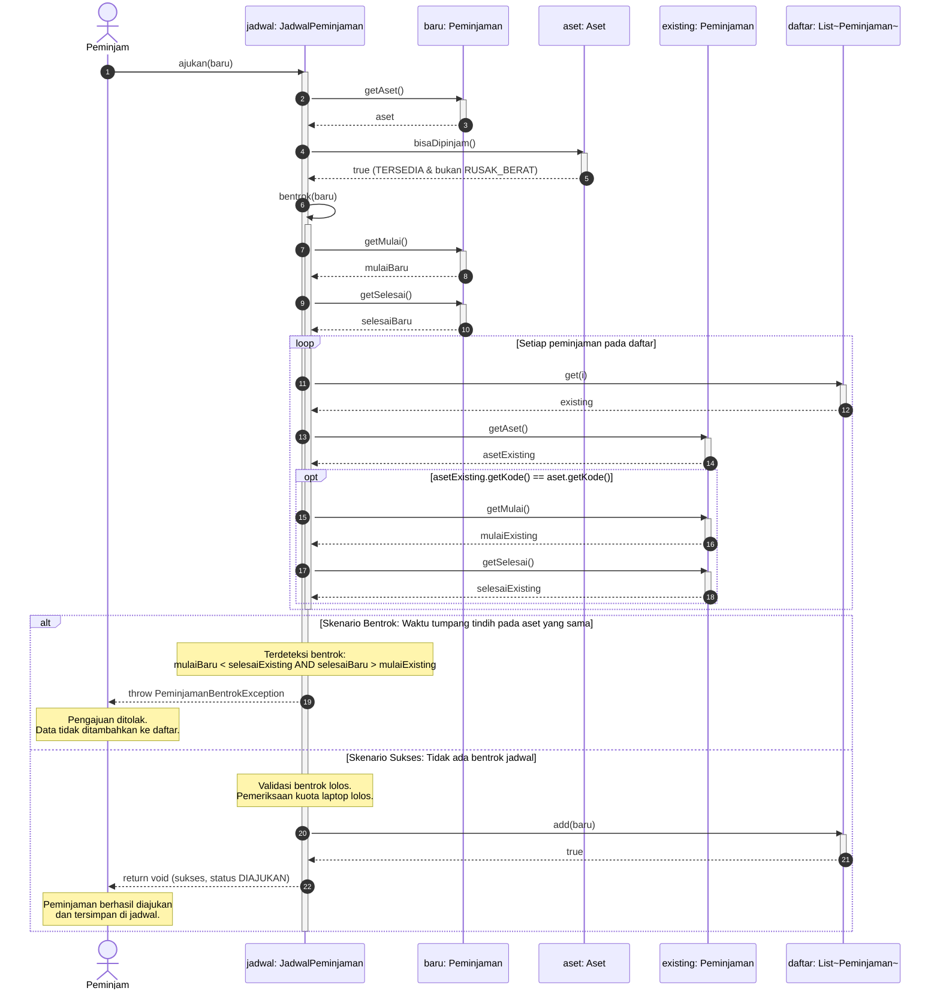

# Sequence Diagram: Pengajuan Peminjaman (`JadwalPeminjaman.ajukan`)

Dokumen ini memodelkan interaksi objek dinamis saat pengajuan peminjaman aset dilakukan ke dalam jadwal (`JadwalPeminjaman`), mencakup **skenario sukses** dan **skenario bentrok** dengan menggunakan fragmen kondisional `alt`.

## Visualisasi Sequence Diagram

---

## Penjelasan Alur Interaksi

1. **Pemanggilan Awal**:
   Aktor peminjam memanggil metode `ajukan(baru)` pada objek `JadwalPeminjaman`.
2. **Pemeriksaan Kelaikan Aset**:
   `JadwalPeminjaman` memanggil `baru.getAset()` lalu memvalidasi ketersediaan aset melalui `aset.bisaDipinjam()`. Berdasarkan aturan bisnis, aset hanya dapat dipinjam bila statusnya `TERSEDIA` dan kondisinya bukan `RUSAK_BERAT`.
3. **Pemeriksaan Bentrok Jadwal (`bentrok(baru)`)**:
   - `JadwalPeminjaman` mengambil rentang waktu peminjaman baru (`getMulai()` dan `getSelesai()`).
   - Sistem melakukan perulangan (*loop*) terhadap seluruh peminjaman yang ada di dalam koleksi `daftar`.
   - Untuk setiap peminjaman yang ada (`existing`), sistem mencocokkan kode aset. Bila kode aset sama, sistem membandingkan interval waktu:
     `mulaiBaru < selesaiExisting && selesaiBaru > mulaiExisting`.
4. **Fragmen Percabangan (`alt`)**:
   - **Skenario Bentrok (`[Terjadi Tumpang Tindih Waktu]`)**:
     - Sistem mendeteksi adanya peminjaman aktif lain pada aset yang sama di rentang waktu tersebut.
     - `JadwalPeminjaman` melempar `PeminjamanBentrokException` (yang menyebutkan kode aset bersangkutan).
     - Pengajuan dibatalkan secara atomik, dan objek `baru` **tidak dimasukkan** ke dalam koleksi jadwal `daftar`.
   - **Skenario Sukses (`[Tidak Ada Bentrok]`)**:
     - Seluruh verifikasi bentrok lolos (dan kuota terpenuhi jika aset berjenis `Laptop`).
     - Objek `baru` ditambahkan ke dalam koleksi `daftar` melalui `daftar.add(baru)`.
     - Peminjaman berstatus awal `DIAJUKAN`.
     - `JadwalPeminjaman` mengembalikan konfirmasi sukses kepada peminjam.
